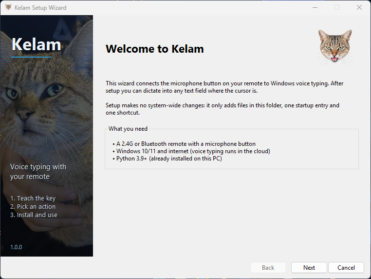

# Kelam

**Connects the microphone button on your remote to Windows voice typing.**
Press the button, speak, and the text appears wherever the cursor is — in any app.

```
[mic button]  →  HID / keyboard bridge  →  Win+H  →  voice typing  →  text
```



## Why a separate app

The microphone button on air-mouse / Android-TV style remotes usually sends HID
`Consumer Page 0x0C`, usage `0x00CF` — **"Voice Command"**. Windows maps this code
to nothing, so on a PC the button looks **dead**. On top of that, these remotes'
firmware does not report press-and-hold: every press sends a press and a release
report back to back (`02 CF 00` → `02 00 00`). A toggle design is therefore the
only correct one.

Kelam does exactly that:

1. Listens to the Consumer Control interface as raw HID (`hid.dll`, no extra packages).
2. On a press it plays a short beep and sends **Win+H**.
3. Windows opens cloud voice typing; audio comes from the remote's own microphone
   (it shows up as a normal USB recording device).

If Windows *does* recognise the remote's key (e.g. `F7`, a media key), the app
automatically switches to a low-level keyboard hook (`WH_KEYBOARD_LL`) and
swallows the original function, so only dictation runs.

## Requirements

| Requirement | Notes |
|---|---|
| Windows 10 / 11 | For Win+H voice typing |
| Python 3.9+ | No third-party packages, standard library only |
| Internet and a microphone | Voice typing runs in the cloud |
| A remote | 2.4G dongle or Bluetooth, with a microphone button |

## Install

### Executable (no Python needed)

Download `Kelam.exe` from [Releases](https://github.com/workaybarsh/kelam-en/releases),
put it in an empty folder and double-click it. The wizard behaves the same way; all
settings are written next to the exe.

> A single file — no `_internal` folder needed. Uninstalling removes that folder too
> (when it only holds Kelam files).

| Command | Purpose |
|---|---|
| `Kelam.exe` | Setup on first run, settings afterwards |
| `Kelam.exe --bridge` | Background bridge (started automatically) |
| `Kelam.exe --uninstall` | Removal wizard |
| `Kelam.exe --uninstall --quiet` | Silent removal, deletes the folder |
| `Kelam.exe --diagnostics out.json` | Paths/commands diagnostics (for tests) |

### From source

1. `git clone https://github.com/workaybarsh/kelam-en.git`
2. Double-click `Kurulum.vbs` (no console window).
3. Follow the wizard:

| Step | What happens |
|---|---|
| Welcome | Next |
| License | Accept the MIT license |
| **Teach the key** | Press the remote's mic button → its identity appears → **confirm with Enter** |
| Action | Win+H (recommended) or a custom hotkey (`ctrl+alt+d`, `f9`, …) |
| Extra tasks | Start with Windows, beep, desktop shortcut |
| Ready | Review → **Install** |
| Done | Close and test the remote |

The bridge starts with Windows from `HKCU\...\CurrentVersion\Run`.

**Changing the key later:** just open the shortcut again. Once an installation
exists, the same window opens as **Settings** — a single screen with your key list,
an **Add key** button and **Save** at the bottom right.

### Manual run

```bat
python wizard.py     :: setup / settings wizard
python bridge.py     :: run the bridge in the foreground (logs to console)
```

## Usage

1. Click into any text field (Notepad, browser, WhatsApp, Excel…).
2. Press the remote's microphone button — a beep plays, Win+H opens.
3. Speak. Windows stops on silence.
4. Press the button again to stop early.

**Multiple keys:** open Settings → **Add key** to bind as many remote buttons as you
like, each with its own action (Win+H or a custom hotkey). Example: mic button →
Win+H, a coloured button → another shortcut.

## Settings

`config.json` (written by the wizard / settings screen). Every key has its own action:

```json
{
  "bindings": [
    {
      "trigger": { "type": "hid", "vid": 6421, "pid": 4133,
                   "usage_page": 12, "usage": 207, "report_id": 2 },
      "action": { "type": "hotkey", "hotkey": "win+h" }
    },
    {
      "trigger": { "type": "hid", "vid": 6421, "pid": 4133,
                   "usage_page": 12, "usage": 548, "report_id": 2 },
      "action": { "type": "hotkey", "hotkey": "ctrl+alt+d" }
    }
  ],
  "beep": false,
  "debounce_ms": 400,
  "autostart": true,
  "swallow": true
}
```

| Field | Meaning |
|---|---|
| `bindings[]` | Key + action pairs; add as many as you need |
| `bindings[].trigger.type` | `hid` = raw HID report, `key` = Windows keyboard key |
| `bindings[].trigger.vid/pid` | USB ids of the receiver (`0x1915` = Nordic Semiconductor) |
| `bindings[].trigger.usage_page/usage` | HID usage (`0x000C` / `0x00CF`) |
| `bindings[].action.hotkey` | Hotkey that this key triggers |
| `beep` | Short beep on trigger (default: off) |
| `debounce_ms` | Window for collapsing rapid press/release reports |
| `swallow` | In key mode, stops the key from reaching the app |

The legacy single-key `trigger`/`action` layout is migrated to `bindings` on load.

## Uninstall

Open the app (shortcut) → **Remove Kelam from this computer**, or use
Windows Settings → Apps → **Kelam** → Uninstall. A removal wizard lists what will
be deleted and then reports what was removed.

Removed: the running bridge, the startup entry (`Run`), the Apps & features entry,
the Start Menu and desktop shortcuts, `config.json`, `bridge.log`, `bridge.pid`,
`bridge.out` and `__pycache__`. Nothing is left behind; in the exe build the
program folder is deleted as well.

## File structure

| File | Purpose |
|---|---|
| `wizard.py` | Setup/settings wizard (Tk) + removal wizard |
| `main.py` | Entry point: wizard / `--bridge` / `--uninstall` / `--diagnostics` |
| `paths.py` | Correct folder resolution for both scripts and frozen exes |
| `bridge.py` | Bridge service driven by settings, single-instance lock |
| `hidbtn.py` | HID layer — `hid.dll` + `setupapi.dll` via ctypes |
| `keyhook.py` | Low-level keyboard hook (capture / swallow) |
| `trigger.py` | HID supervisor + capture session, automatic reconnection |
| `hotkey.py` | Hotkey sending and formatting |
| `config.py` | `config.json` schema and defaults |
| `service.py` | Process control, startup entry, shortcuts, uninstall entry |
| `assets/` | Icon, wizard panel and logo (built by `make_assets.py`) |
| `tools/make_assets.py` | Builds icon/panel/logo from `assets/source-*` |
| `tools/capture_screens.py` | Regenerates the screenshots in `docs/` |
| `Kurulum.vbs` | Starts the wizard without a console |

## Limits

- **No press-and-hold**: the firmware does not report it, so the design is a toggle.
- **Win+H uses the default microphone.** If the default input is another device,
  dictation listens to that one; pick your call device inside each app instead.
- Password fields and some protected apps refuse dictation.
- Speech recognition runs in the cloud and needs internet. A fully local option
  can be plugged in with a `faster-whisper` engine.

## Development

```bat
build.ps1                     :: builds dist\Kelam.exe (PyInstaller, single file)
python tests/test_flow.py     :: end-to-end install + uninstall test (55 checks)
python tests/test_exe.py      :: packaged exe test (17 checks)
python tools/capture_screens.py  :: regenerates docs/ screenshots
```

The tests really run the wizard: they walk the pages programmatically, feed the
key capture a synthetic HID report, verify the settings/startup entry/shortcuts the
install wrote, then uninstall and check that no trace remains.

## License

[MIT](LICENSE) © 2026 workaybarsh
